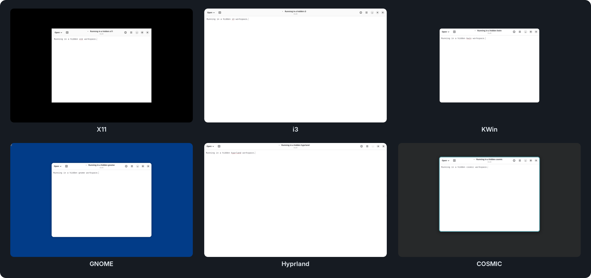

<h1 align="center">agent-workspace-linux</h1>

<p align="center">
  <a href="https://github.com/agent-sh/agent-workspace-linux/actions/workflows/ci.yml"></a>
  <a href="https://github.com/agent-sh/agent-workspace-linux/releases/latest"></a>
  <a href="https://www.npmjs.com/package/@agent-sh/agent-workspace-linux"></a>
  
  <a href="LICENSE"></a>
</p>

<p align="center"><b>A hidden Linux desktop that an AI agent controls over MCP.</b><br>Your mouse, keyboard, focus and browser stay yours.</p>

<p align="center">
  
</p>
<p align="center"><sub>One agent, six hidden desktops. Each tile is a real workspace on one machine, captured by the agent itself.</sub></p>

<p align="center">
  <a href="#install">Install</a> ·
  <a href="#quick-start">Quick start</a> ·
  <a href="#desktop-backends">Backends</a> ·
  <a href="#browser-automation">Browser</a> ·
  <a href="#security-model">Security</a> ·
  <a href="#limitations">Limitations</a> ·
  <a href="#docs">Docs</a>
</p>

> Running open models for your company? [**Tiyuvta**](https://tiyuvta.ai/services/) helps with model choice, deployment and optimization, and fine-tuning on your hardware or cloud account.

Agents that "use a computer" usually take over *your* screen. They move your mouse, steal focus and drive your logged-in browser. `agent-workspace-linux` gives the agent its **own** desktop: a private X11 or native Wayland display with its own window manager or compositor, apps, clipboard and browser, on any of [six backends](#desktop-backends). The agent launches apps, types, clicks, takes screenshots and browses there. You watch, pause or stop it from a small floating viewer. It speaks [MCP](https://modelcontextprotocol.io) over stdio, so it works with Claude Code, Codex and other MCP hosts.

## Why this project

| Use case | When |
|---|---|
| **GUI and web QA** | An agent must test an app or website without hijacking your desktop or Chrome session. |
| **Isolated browsing** | Web or shopping automation should run in a throwaway profile you can watch and stop. |
| **Clean desktops** | You need a fresh Linux desktop to run, screenshot and inspect an app, then tear it down. |
| **Unattended agents** | A long-running or headless agent needs a desktop of its own. |

This is not a tool for driving your actual desktop. For that, use its sibling [computer-use-linux](https://github.com/agent-sh/computer-use-linux). The two complement each other.

## Install

**1. System packages.** These cover the default X11 backend:

```bash
sudo apt install xvfb openbox xdotool xauth x11-utils imagemagick xclip \
    bubblewrap uidmap pkg-config libxkbcommon-x11-dev
```

Other backends need [their own packages](#backend-packages).

**2. The binary.** Pick one:

```bash
# From a clone: builds into ~/.local/bin/ and installs the bundled skill (safe to rerun)
./install.sh

# npm: downloads the prebuilt binary from the matching release and checks its sha256
npm install -g @agent-sh/agent-workspace-linux

# cargo: builds from git and installs only the binary (add --tag v0.5.1 to pin)
cargo install --git https://github.com/agent-sh/agent-workspace-linux
```

Prebuilt `x86_64` and `aarch64` binaries with `.sha256` sidecars are on [GitHub Releases](https://github.com/agent-sh/agent-workspace-linux/releases/latest). Verify with `sha256sum -c`, `chmod +x`, and put the binary on your `PATH`.

**3. Register the MCP server.** For hosts that read `.mcp.json`:

```json
{
  "mcpServers": {
    "agent-workspace-linux": {
      "command": "/home/YOU/.local/bin/agent-workspace-linux",
      "args": ["mcp"]
    }
  }
}
```

<details>
<summary><b>install.sh flags and Codex setup</b></summary>

<br>

`./install.sh` installs the skill to `~/.codex/skills/` by default. Codex MCP registration is opt-in: use `--codex-configure` only for generic MCP-host workflows. In Codex for Linux, use the dedicated **Agent Workspaces** feature page to configure the backend and permission ceiling, so the generic MCP settings pages stay clean. If an older install still appears there, run `./install.sh --clean-codex-config` to remove the stale server and tool tables.

Other flags: `--permissions`, `--skills-dir`, `--no-skill`, `--dry-run`. See [`install.sh --help`](install.sh).

With cargo or a prebuilt binary, copy `skills/agent-workspace-linux/` into your skills directory if you want the bundled skill.

</details>

## Quick start

```bash
# 1. What can this machine run? (dependencies, display, sandbox backends)
agent-workspace-linux doctor

# 2. Preview a workspace without creating anything
agent-workspace-linux workspace start --dry-run

# 3. Create the hidden workspace (explicit acknowledgement required)
agent-workspace-linux workspace start --ack-hidden-workspace --purpose "QA run"

# 4. Watch it in the floating viewer
agent-workspace-linux viewer

# 5. Launch an app, look at it, stop the workspace
agent-workspace-linux workspace launch --name editor -- xterm
agent-workspace-linux workspace observe --screenshot --output /tmp/ws.png
agent-workspace-linux workspace stop
```

Through an MCP host you don't run these by hand. The agent calls the matching tools, routed by the [bundled skill](#the-skill).

## Desktop backends

Choose a backend with `--session` on `workspace start` and `workspace open-profile`, or with `"session": {"backend":"hyprland"}` in MCP calls and saved profiles. Explicit CLI or MCP input overrides the profile. With neither, the workspace uses X11.

| Backend | `--session` | What runs | Scale | GPU |
|---|---|---|---|---|
| **X11** (default) | `x11` | Xvfb + Openbox | 1 | none |
| **i3** | `i3` | Xvfb + i3 | 1 | none |
| **KWin** | `kwin` | KWin 6.6+ virtual Wayland compositor | fractional | render node |
| **GNOME** | `gnome` | GNOME Shell 50/51 + Mutter, headless | fractional | none |
| **Hyprland** | `hyprland` | Hyprland 0.53 on a private KWin renderer | fractional | render node |
| **COSMIC** | `cosmic` | `cosmic-comp` under a headless Weston parent | fractional | none |

`doctor` reports `ready_for_<backend>_workspace` for each one and lists anything missing.

### Backend packages

Extra packages on top of the [X11 set](#install), for Ubuntu 26.04:

| Backend | Packages |
|---|---|
| i3 | `i3-wm` |
| KWin | `kwin-wayland kwin-common libkscreen-bin libkf6service-bin wl-clipboard xwayland dbus-daemon` |
| GNOME | `gnome-shell xwayland libglib2.0-bin dbus-daemon` |
| Hyprland | `hyprland kwin-wayland xwayland grim wtype wl-clipboard dbus-daemon` |
| COSMIC | `weston xwayland x11-xserver-utils wl-clipboard dbus-daemon`, plus `cosmic-comp` (below) |

"Render node" means your user can read and write a `/dev/dri/renderD*` device, usually through the `render` group. On a host with an NVIDIA GPU and another GPU, Hyprland renders on the other one.

<details>
<summary><b>Installing cosmic-comp on Ubuntu</b></summary>

<br>

Ubuntu does not package `cosmic-comp`. Install the Pop!_OS build that the COSMIC probe pins, with its `libdisplay-info1` dependency:

```bash
curl -fLO https://apt.pop-os.org/release/pool/noble/cosmic-comp/8cb1802caada438bb5cc7670dfabdaca5fad0502/cosmic-comp_0.1~1792508925~24.04~8cb1802_amd64.deb
curl -fLO https://archive.ubuntu.com/ubuntu/pool/universe/libd/libdisplay-info/libdisplay-info1_0.1.1-2build1_amd64.deb
sha256sum -c <<'EOF'
f493771502e56245158906e92b4da0b5a7f0bc2fb1926f3feb81d6294541b427  cosmic-comp_0.1~1792508925~24.04~8cb1802_amd64.deb
a3bfce18d53aa9d635d899f1f555e84bbbf2c859d80cef3b4eb1c36b2c772026  libdisplay-info1_0.1.1-2build1_amd64.deb
EOF
sudo apt install ./cosmic-comp_0.1~1792508925~24.04~8cb1802_amd64.deb ./libdisplay-info1_0.1.1-2build1_amd64.deb
```

</details>

### Scale and coordinates

Use `--scale 1.5` (or `"scale":1.5` in a profile or MCP `session`) on KWin, GNOME, Hyprland or COSMIC for a 150% output. On every native Wayland backend, width, height, window geometry and pointer coordinates are screenshot pixels:

- **KWin** converts between those pixels and its logical coordinates. It aligns output sizes to logical pixels; status reports the effective size.
- **GNOME, Hyprland and COSMIC** use physical pixels throughout, including at fractional scales.

Apps use native Wayland by default. Rootless XWayland stays available for legacy clients. The viewer, IPC, permission ceiling and Chrome profile import rules are the same on every backend.

### Backend notes

<details>
<summary><b>KWin</b></summary>

<br>

KWin runs as a native Wayland virtual compositor, with no Xvfb underneath. Each workspace owns its Wayland socket, session D-Bus, settings, input and clipboard. This is KWin, not the full Plasma shell.

</details>

<details>
<summary><b>GNOME</b></summary>

<br>

GNOME Shell and Mutter run with a private headless output and software rendering, with no GPU or parent compositor.

```bash
agent-workspace-linux workspace start --ack-hidden-workspace \
    --session gnome --scale 1.5 --width 1200 --height 900
```

- **Scale.** Mutter validates scale against the physical output mode: 1200x900 supports 150%, 960x720 does not. Unsupported combinations fail at startup. GTK clients may use a larger integer buffer scale on fractional outputs.
- **Text input.** Native Unicode text needs a focused Wayland text-input field. A request that cannot be typed in full is rejected before any key is sent. Legacy editable fields (GTK, Qt, Chromium, Firefox, Electron) use the private accessibility bus, with client PID, focus, caret, selection and text readback checks. Unsupported legacy fields return an error rather than drop characters.
- **xterm.** Text goes through PRIMARY and xterm's Shift+Insert binding. A short-lived X client owns PRIMARY, serves the text once to that xterm only, then exits and leaves PRIMARY empty. CLIPBOARD is not touched.
- **Screenshots.** Window screenshots paint the window offscreen and do not change focus or stacking.
- **Locked-down shell.** The session has private session and accessibility buses and an empty system bus. A bundled Shell extension exposes fixed controls only to the workspace daemon. The overview, run dialog, settings launchers and unrelated extensions are disabled, and Shell Eval and extension installation are denied on its bus.

</details>

<details>
<summary><b>Hyprland</b></summary>

<br>

Hyprland runs on a private KWin renderer with a separate headless output, native toplevel capture and authenticated XWayland. See [the Hyprland guide](docs/hyprland.md).

</details>

<details>
<summary><b>COSMIC</b></summary>

<br>

`cosmic-comp` runs under a software-only Weston headless parent, with no host display, input device or GPU. It supports fractional scaling and authenticated XWayland clients. See [COSMIC setup and isolation](docs/native-cosmic.md) for its private launcher restrictions.

</details>

<details>
<summary><b>i3</b></summary>

<br>

A private Xvfb display with i3 at scale 1. The private i3 config has no launcher bindings, bar or startup commands. Moving or resizing a tiled window makes it floating. Minimize uses the i3 scratchpad; show returns the window to the current workspace. Window capture leaves focus unchanged.

</details>

## Browser automation

Browser commands need a workspace-owned Chrome with loopback DevTools. `open-browser` launches one with the right flags:

```bash
# Launch workspace-owned Chrome (--dry-run prints the argv first)
agent-workspace-linux workspace open-browser --dry-run
agent-workspace-linux workspace open-browser "http://127.0.0.1:8111"

# Drive it; the URL is positional
agent-workspace-linux workspace browser-navigate "http://127.0.0.1:8111/page" --wait-ms 1500
agent-workspace-linux workspace browser-snapshot --max-text-chars 2000
```

`browser-navigate` and `browser-click` re-read the page after acting, so `target.url` and `target.title` describe the page you landed on. If that refresh fails, the response carries a warning rather than stale metadata.

<details>
<summary><b>Attaching your own CDP client</b></summary>

<br>

DevTools binds to an ephemeral loopback port, and Chrome rejects WebSocket upgrades whose `Origin` is not allow-listed, port included. No static `--remote-allow-origins` value can match (`*` would, but it disables that CSRF protection). Omit the `Origin` header instead:

```python
ws = websocket.create_connection(ws_debugger_url, suppress_origin=True)
```

</details>

## Security model

### Who controls the boundaries

| Scenario | Who sets the boundary | What is enforced | Runtime override? |
|---|---|---|---|
| **Default** (no `--permissions`) | Your **agent host** (Claude Code, Codex, ...) | No ceiling of its own; the host's approval flow applies. One explicit hidden-workspace acknowledgement scopes workspace-local actions to that environment. | Yes. The host and user own approvals. |
| **Developer ceiling** (`--permissions file.json` or `AGENT_WORKSPACE_PERMISSIONS`) | The **developer or operator** who launched the MCP | Network mode, mount paths and an app allowlist, enforced at the MCP front end **and** the daemon's IPC socket, so workspace apps and other same-uid processes are capped too. | **No.** Only by restarting the MCP. This is the authoritative boundary. |
| **Live viewer control** (pause, read-only) | The **human watching** | Honors a runtime pause when the shared control state is readable. If the daemon cannot read it, mutating IPC fails closed while inspection and stop stay available. | A convenience layer, not the security boundary. |
| **Workspace vs. host** | The **runtime** | Input, screenshots, windows, clipboard and browser control target the hidden workspace only, never your desktop or host Chrome. | Leakage to the host is a reportable bug. |

By default the agent host owns permission. A developer can lock a hard, daemon-enforced ceiling. The viewer gives a human live pause, read-only and stop. See [docs/permission-model.md](docs/permission-model.md) and [SECURITY.md](SECURITY.md).

### What a sandboxed app sees

- **Its own namespaces.** Sandboxed apps get private process namespaces and only the workspace display, an application bus without compositor methods, the accessibility bus and, for a managed terminal, that terminal's own socket directory.
- **No host desktop IPC.** Network-only profiles keep normal host file access but hide every workspace runtime and the host session bus, system bus, X11 sockets and IBus.
- **A filtered Wayland socket.** On Hyprland, KWin and COSMIC, a filter forwards only an allow-list of ordinary app globals. Capture, input injection, input method, toplevel and workspace management, layer shell, session lock, output control and clipboard-manager globals stay hidden, and binds of hidden names are refused. The daemon's own helpers keep the unfiltered socket. `scripts/sandbox_wayland_globals_smoke.py` checks this on each native backend.
- **No supplementary groups** where the host allows it (see [Limitations](#limitations)).

> [!WARNING]
> The Wayland filter does not cover X11. Sandboxed apps share the workspace's X11 display (Xvfb or XWayland) and accessibility bus with its other apps. Do not run untrusted sandboxed apps next to unsandboxed apps or terminals in the same workspace.

Unsandboxed apps and attached controllers such as computer-use-linux use the compositor control bus, as in a regular desktop session.

### Cleanup

Managed terminal sessions end when their workspace stops, even after the terminal window has closed. Stale cleanup uses the saved launch and session identity. Verified terminal cleanup uses Linux pidfds; older kernels without `SO_PEERPIDFD` use `pidfd_open` with process, session and exact socket-argument checks. If ownership cannot be verified, stop and cleanup keep the runtime and report an error instead of signaling an unrelated process.

## Core concepts

| Concept | What it is |
|---|---|
| **Hidden workspace** | A private X11 or Wayland display, window manager or compositor, and control socket. Apps launched into it attach to that display, not your session. Creating one needs `--ack-hidden-workspace`, so it is never silent. |
| **Permission ceiling** | Optional JSON (`network`, `mounts`, `apps`), enforced for the life of the MCP process. Mount and network isolation use [bubblewrap](https://github.com/containers/bubblewrap). |
| **Profiles** | Reusable workspace definitions: mounts, network mode, setup commands, startup apps. Start from `profile template project-dev` or `browser-session`. |
| **Viewer** | A small GPUI window with workspace state, a live screen view and pause, read-only and stop controls. Not always-on-top by default. |
| **Workspace browser** | Workspace-owned Chrome or Chromium over a loopback DevTools endpoint, so automation never attaches to your host Chrome. |

## The skill

The MCP exposes about 86 tools. To keep them out of the agent's context, it ships a skill at [`skills/agent-workspace-linux/SKILL.md`](skills/agent-workspace-linux/SKILL.md). Only its short description stays loaded. When a task needs an isolated desktop or browser, the agent reads the skill, which routes it through the phases (orient, start, observe, act, stop) and loads tool schemas on demand.

`./install.sh` installs it to `~/.codex/skills/`. Use `--skills-dir ~/.claude/skills` for Claude.

## Features

- Hidden X11 or native Wayland workspaces on six backends, with window listing, screenshots, keyboard and mouse input, clipboard and per-app logs, all scoped to the workspace.
- An optional, daemon-enforced permission ceiling (network, mounts, app allowlist).
- bubblewrap mount and network isolation: `disabled`, `local_only`, `inherit_host`.
- Workspace-owned browser control over loopback CDP: discover targets, read pages, navigate, extract results.
- A native floating viewer with live pause, read-only and stop.
- Saved profiles with setup and startup commands.
- A bundled skill for low-context, on-demand tool use.

## Limitations

- **Linux only.** The viewer is validated on X11 and XWayland; native Wayland support is still maturing.
- **Pre-1.0.** Interfaces and tool schemas can change between versions.
- **Single-user trust model.** The control socket is a same-uid Unix socket (mode 0600), with no cross-user protection by design. Run as a dedicated user for multi-user isolation.
- **Mount and network enforcement needs bubblewrap.** Without it, those policies are declared but not enforced, and the runtime says so.
- **Live viewer control is not the hard boundary.** The permission ceiling is. Unreadable live-control state fails closed for mutating daemon IPC.
- **Supplementary groups are dropped only where the host allows it.** Groups such as `docker` or `lxd` are root-equivalent. Where any requirement below is missing, sandboxed apps keep your groups as before, and `doctor` reports why under `sandbox_group_drop`.

<details>
<summary><b>Requirements and effects of dropping groups</b></summary>

<br>

Dropping needs:

- `uidmap` (`newuidmap`, `newgidmap`);
- a subordinate id range for your user in `/etc/subuid` and `/etc/subgid` (Ubuntu's `adduser` creates one);
- util-linux 2.40 or newer;
- user namespaces that `unshare` may use, on a host without `no_new_privs`.

Ubuntu 23.10 and newer restrict unprivileged user namespaces with AppArmor (`kernel.apparmor_restrict_unprivileged_userns=1`). To allow it, either give `/usr/bin/unshare` an AppArmor profile with `userns,` (like Ubuntu's own `lxc-usernsexec` profile; this lifts the restriction for every program that runs `unshare`), or set the sysctl to 0. Or remove the root-equivalent groups from your user.

When dropping applies, every supplementary group goes, including `video`, `audio` or a shared project group. Files a sandboxed app could reach only through such a group become unreadable to it.

</details>

## Validation

Each native backend has a disposable Ubuntu 26.04 acceptance probe. Build the binary, then run the script; each prints its artifact directory and returns nonzero on failure.

| Script | What it checks |
|---|---|
| `scripts/gnome_probe.sh` | Real GTK input at 100% and 150%, clipboard, window operations, physical screenshot sizes, MCP and viewer IPC, private-bus restrictions, managed terminal cleanup, native and XWayland apps under enforced mount and network isolation. No host display, input device, system bus or GPU. Override `GNOME_PROBE_BIN` and `GNOME_PROBE_ARTIFACT_DIR`. |
| `scripts/kwin_probe.sh` | Actual 100% and 150% scaling, native Qt input and capture, MCP startup, viewer frames, denied desktop-service activation, a legacy terminal with enforced isolation. One DRM render node, no host display, input device or session runtime. |
| `scripts/kwin_cul_probe.sh` | computer-use-linux against the same KWin desktop: AT-SPI activation, global logical-coordinate clicks and client-local element fallback on a Qt window at 150%. Set `KWIN_PROBE_BIN` and `COMPUTER_USE_LINUX_BIN`. |
| `scripts/hyprland_probe.sh` | See [the Hyprland guide](docs/hyprland.md). |
| `scripts/cosmic_probe.sh` | See [COSMIC setup and isolation](docs/native-cosmic.md). |
| `scripts/i3_smoke.py` | The real private i3 session and restricted apps. Set `AGENT_WORKSPACE_BIN`. |

The KWin containers permit nested user namespaces so the bubblewrap checks can run. Portal consent in the computer-use-linux probe applies only to the disposable workspace.

<details>
<summary><b>Real-profile browser-session dogfood</b></summary>

<br>

For Slack or GitHub account-session validation, the only human step is approving the Chrome or Chromium user-data directory:

```sh
node scripts/mcp_real_profile_browser_session_dogfood.js \
  --approved-user-data-dir ~/.config/google-chrome \
  --site github
```

The helper refuses obvious active-profile hazards, copies the approved profile to a disposable directory, launches the `browser-session` template through the MCP and proves the logged-in page with workspace browser tools, not the host Chrome bridge. Use `--site slack` for Slack, set `BROWSER_BIN=chromium` when needed, and add `--expect-text` for account-specific page text.

</details>

## Docs

- [Permission boundary](docs/permission-model.md): the authority model.
- [Hyprland backend](docs/hyprland.md) and [COSMIC backend](docs/native-cosmic.md): dependencies, isolation and probes.
- [GPUI viewer direction](docs/gpui-viewer-direction.md): the visible control surface.
- [SECURITY.md](SECURITY.md): trust model and vulnerability reports.

## Related

[computer-use-linux](https://github.com/agent-sh/computer-use-linux) drives the **user's real** Linux desktop. It is the inverse of this project: it automates the desktop you are on, while `agent-workspace-linux` gives the agent a separate, isolated one. Use them together for host control and a sandboxed agent workspace.

## Contributing

Build with `cargo build --locked`. Before pushing, run `cargo fmt --check`, `cargo clippy --locked -- -D warnings`, `cargo test --locked`, `git diff --check` and, for runtime changes, `scripts/integration_smoke.sh`. See [CONTRIBUTING.md](CONTRIBUTING.md) and [CODE_OF_CONDUCT.md](CODE_OF_CONDUCT.md).

## License

[MIT](LICENSE) © Avi Fenesh
